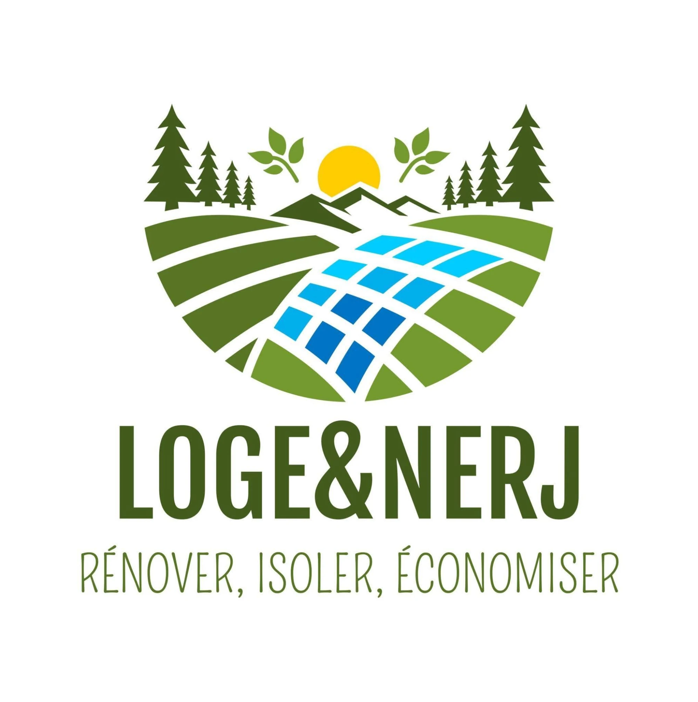

# Charte graphique LOGE&NERJ

Source de référence : le logo officiel de Michael, `assets/brand/logo-officiel.webp` (fichier d'origine, reçu le 10/11/2026). Tout ce qui suit en découle. Version visuelle : `charte.html`.

## Ce que dit le logo

Un paysage : sapins, montagnes, soleil levant, deux rameaux de feuilles. Des champs en bandes arrondies séparées par du blanc, et au centre des panneaux bleus en damier qui évoquent à la fois l'isolation, le solaire et le carrelage. Dessous, LOGE&NERJ en capitales étroites et grasses, puis la signature « Rénover, isoler, économiser » au trait fin dessiné.

L'esprit à garder : nature, économie d'énergie, travail propre et lisible. Pas de look industriel ni de chantier agressif.

## Logo

Ne jamais le redessiner, le recolorer, le déformer ni le poser sur une photo chargée.

| Fichier | Usage |
|---|---|
| `logo-officiel.webp` | Référence, documents, devis, factures |
| `logo-transparent(-900).webp` | Logo complet détouré, pied de page |
| `embleme(-400, -160).webp` | Emblème seul, en-tête, chat |
| `favicon-32.png`, `favicon-192.png` | Onglet, écran d'accueil du téléphone |
| `og-image.jpg` | Aperçu quand on partage le lien |

Sur fond foncé, l'emblème se met dans une pastille blanche. Taille minimale de l'emblème à l'écran : 40 px de haut.

Les dérivés sont détourés automatiquement depuis le fichier d'origine. Un fichier vectoriel (SVG, AI, PDF) serait mieux : à demander à Michael ou à son graphiste.

## Couleurs

Relevées au pixel sur le logo.

| Nom | Code | Rôle sur le site |
|---|---|---|
| Vert forêt | #425A1B | Logotype, titres, boutons principaux, menu actif |
| Forêt profonde | #2F4113 | Fonds sombres (coupe de mur, bandeau maquette) |
| Vert champ | #597424 | Survol des boutons |
| Vert feuille | #749A30 | Accents, numéros, soulignement des liens, signature |
| Bleu ciel | #01CCFF | Focus des champs de formulaire, dégradé panneaux |
| Azur | #01B0EB | Étiquette carrelage, dégradé panneaux |
| Bleu panneau | #006CC0 | Fin du dégradé panneaux |
| Soleil | #FFCD01 | Boutons d'action (devis, appel), mètre, niveau à bulle |
| Papier | #FBFBF6 | Fond général |
| Papier vert | #F1F4E8 | Blocs, cartes secondaires |
| Encre | #1F2C0E | Texte courant |

Règle simple : le vert structure, le jaune fait agir, le bleu rappelle les panneaux (carrelage, isolation).

## Typographies (Google Fonts, gratuites)

- Oswald 500 à 700, en capitales : titres, boutons, menus, étiquettes. C'est la plus proche du logotype.
- Amatic SC 700 : petites touches seulement (signature, accroches, légendes), comme le trait de « Rénover, isoler, économiser ».
- Nunito Sans 400 à 700 : tout le texte courant.

## Formes et liens

- Coins arrondis (18 px pour les blocs, pastilles pour les boutons et étiquettes).
- Blocs voisins séparés par un filet blanc de 6 px, comme les champs du logo.
- Bandes de champs incurvées (`assets/brand/champs.svg`) entre les grandes parties et avant le pied de page.
- Liens dans le texte : vert forêt, gras, soulignés en vert feuille épais. Au survol, un surlignage jaune soleil.
- Boutons : jaune soleil pour l'action principale, vert forêt pour le reste, contour vert pour les actions secondaires.
- Pas d'ombres dures, pas d'emojis, pas de dégradés décoratifs (sauf le dégradé bleu des panneaux).

## Signature

« Rénover, isoler, économiser » est le titre de l'accueil. « Isoler » prend le dégradé bleu des panneaux, le point final est un soleil jaune.

## À valider avec Michael

Les couleurs, les trois polices, la place de l'emblème dans l'en-tête, la signature en titre d'accueil, le jaune pour les boutons de devis. Et savoir s'il est RGE : la signature parle d'économies d'énergie, ses clients poseront la question des aides.
